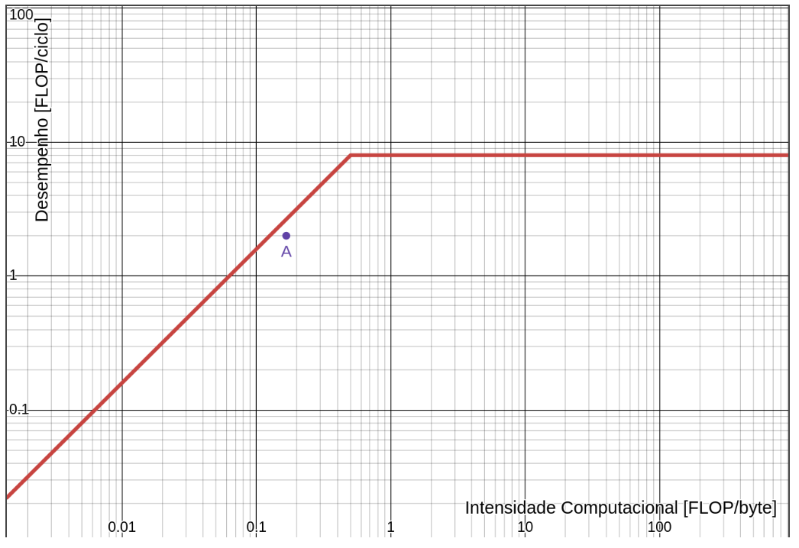

## Configuração Base

* `L = 4`  
* `VLMAX = 16`
* `B = 16`
* `N_VALU = 1`
* `n = 64` então `vl = VMAX = 16`
* `P_peak = 8`
* `I_inf = 0,5`

#### Instruções

| Instruçao | T | N_FLOPS |
|:---------:|:-:|:-------:|
|   VSETVL  | 1 |    0    |
|   VLOAD   | 4 |    0    |
|   VSTORE  | 4 |    0    |
|    VFMA   | 4 |    32   |
|   VSPLAT  | 4 |    0    |
|    ADD    | 1 |    0    |
|    SLLI   | 1 |    0    |
|    BNE    | 1 |    0    |

### Trace

Para essa congiguração, como `n/vl = 64/16 =4`, o loop deve ser executado 4 vezes para que o kernel seja finalizado. Na tabela abaixo, há o trace até a terceira execução do loop.

|  k |     Instruçao    | vl | Unidade |  E |  I |  F |
|:--:|:----------------:|:--:|:-------:|:--:|:--:|:--:|
|  1 |   VSETVL x2, x1  |  - |   ALU   |  1 |  1 |  1 |
|  2 |   VSPLAT v1, f1  | 16 |   VALU  |  2 |  2 |  5 |
|  3 |  SLLI x3, x2, 2  | 16 |   ALU   |  3 |  3 |  3 |
|  4 |  ADD x4, x0, x0  |  - |   ALU   |  4 |  4 |  4 |
|  5 |  ADD x4, x4, x2  |  - |   ALU   |  5 |  5 |  5 |
|  6 |  VLOAD v2, (x5)  | 16 |   LSU   |  6 |  6 |  9 |
|  7 |  VLOAD v3, (x6)  | 16 |   LSU   | 10 | 10 | 13 |
|  8 |  VFMA v3, v2, v1 | 16 |   VALU  | 11 | 14 | 17 |
|  9 |  VSTORE v3, (x6) | 16 |   LSU   | 14 | 18 | 21 |
| 10 |  ADD x5, x5, x3  |  - |   ALU   | 15 | 15 | 15 |
| 11 |  ADD x6, x6, x3  |  - |   ALU   | 16 | 16 | 16 |
| 12 | BNE x4, x1, LOOP |  - |   ALU   | 17 | 17 | 17 |
| 13 |  ADD x4, x4, x2  |  - |   ALU   | 18 | 18 | 18 |
| 14 |  VLOAD v2, (x5)  | 16 |   LSU   | 22 | 22 | 25 |
| 15 |  VLOAD v3, (x6)  | 16 |   LSU   | 26 | 26 | 29 |
| 16 |  VFMA v3, v2, v1 | 16 |   VALU  | 27 | 30 | 33 |
| 17 |  VSTORE v3, (x6) | 16 |   LSU   | 30 | 34 | 37 |
| 18 |  ADD x5, x5, x3  |  - |   ALU   | 31 | 31 | 31 |
| 19 |  ADD x6, x6, x3  |  - |   ALU   | 32 | 32 | 32 |
| 20 | BNE x4, x1, LOOP |  - |   ALU   | 33 | 33 | 33 |
| 21 |  ADD x4, x4, x2  |  - |   ALU   | 34 | 34 | 34 |
| 22 |  VLOAD v2, (x5)  | 16 |   LSU   | 38 | 38 | 41 |
| 23 |  VLOAD v3, (x6)  | 16 |   LSU   | 42 | 42 | 45 |
| 24 |  VFMA v3, v2, v1 | 16 |   VALU  | 43 | 46 | 49 |
| 25 |  VSTORE v3, (x6) | 16 |   LSU   | 46 | 50 | 53 |
| 26 |  ADD x5, x5, x3  |  - |   ALU   | 47 | 47 | 47 |
| 27 |  ADD x6, x6, x3  |  - |   ALU   | 48 | 48 | 48 |
| 28 | BNE x4, x1, LOOP |  - |   ALU   | 49 | 49 | 49 |
| 29 |  ADD x4, x4, x2  |  - |   ALU   | 50 | 50 | 50 |
| 30 |  VLOAD v2, (x5)  | 16 |   LSU   | 54 | 54 | 57 |
| 31 |  VLOAD v3, (x6)  | 16 |   LSU   | 58 | 58 | 61 |
| 32 |  VFMA v3, v2, v1 | 16 |   VALU  | 59 | 62 | 65 |
| 33 |  VSTORE v3, (x6) | 16 |   LSU   | 66 | 66 | 69 |
| 34 |  ADD x5, x5, x3  |  - |   ALU   | 67 | 67 | 67 |
| 35 |  ADD x6, x6, x3  |  - |   ALU   | 68 | 68 | 68 |
| 36 | BNE x4, x1, LOOP |  - |   ALU   | 69 | 69 | 69 |

### Extrapolação Analítica

Podemos dividir o algorítmo em dois blocos:

1. **Fora do loop**: a sequência executada apenas uma vez, instruções de k=1 até k=4.

| k |  E |  F |
|:-:|:--:|:--:|
| 1 |  1 |  1 |
| 2 |  2 |  5 |
| 3 |  3 |  3 |
| 4 |  4 |  4 |

> Nesse bloco, o total de ciclos será dado por `max(F) - min(E) + 1 = F_4 - E_1 + 1 = 4 - 1 + 1 = 4`.

2. **Dentro do loop:** A sequência executada `n/vl` vezes. Na primeira execução do loop (de k=5 à k=12), temos:

| k  | j | E  |  F |
|:--:|:-:|:--:|:--:|
| 5  | 1 |  5 |  5 |
| 6  | 2 |  6 |  9 |
| 7  | 3 | 10 | 13 |
| 8  | 4 | 11 | 17 |
| 9  | 8 | 14 | 21 |
| 10 | 6 | 15 | 15 |
| 11 | 7 | 16 | 16 |
| 12 | 8 | 17 | 17 |

> `max(F) - min(E>F_4) + 1 = F_9 - E_5 + 1 = 21 - 5 + 1 = 17`.

Segundo loop

| k  |  E |  F |
|:--:|:--:|:--:|
| 13 | 18 | 18 |
| 14 | 22 | 25 |
| 15 | 26 | 29 |
| 16 | 27 | 33 |
| 17 | 30 | 37 |
| 18 | 31 | 31 |
| 19 | 32 | 32 |
| 20 | 33 | 33 |

> `max(F) - min(E>F_12) + 1 = F_17 - E_14 + 1 = 37 - 22 + 1 = 16`.

Terceiro loop

| k  |  E |  F |
|:--:|:--:|:--:|
| 21 | 34 | 34 |
| 22 | 38 | 41 |
| 23 | 42 | 45 |
| 24 | 43 | 49 |
| 25 | 46 | 53 |
| 26 | 47 | 47 |
| 27 | 48 | 48 |
| 28 | 49 | 49 |

> `max(F) - min(E>F_17) + 1 = F_25 - E_22 + 1 = 53 - 38 + 1 = 16`.

| k  |  E |  F |
|:--:|:--:|:--:|
| 29 | 50 | 50 |
| 30 | 54 | 57 |
| 31 | 58 | 61 |
| 32 | 59 | 65 |
| 33 | 66 | 69 |
| 34 | 67 | 67 |
| 35 | 68 | 68 |
| 36 | 69 | 69 |

> `max(F) - min(E>F_25) + 1 = F_36 - E_30 + 1 = 69 - 54 + 1 = 16`.

> ciclos(n=64) = 4 + 17 + 3*16 = 69

> ciclos(n=64) = 5 + 4 * 16 = 5 + 64 

> ciclos(n) = 5 + n

> ciclos(n=16) = 5 + 16 = 21

> ciclos(n=32) = 5 + 32 = 37

> ciclos(n=48) = 5 + 48 = 53

> ciclos(n=1024) = 5 + 1024 = 1029

> ciclos(n=2^20) = 5 + 2^20 = 5 + 1048576 = 1048581

### Desempenho e Roofline

#### 1. Número de FLOPs

A operações de ponto de ponto flutuante ocorrem somente na instrução `VFMA`. Portanto, como essa instrução ocorre uma vez por loop e nenhuma vez fora dos loops. Como, para `vl=16` a instrução `VFMA` executa 32 FLOPs e quantidade de loops é dada por `n/vl=n/16`, então:

> ```
> N_FLOPS = 32*n/16 = 2n
> => N_FLOPS(n=2^20) = 2*2^20 = 2^21
> ```

#### 2. Tráfego

O tráfego, que se refere à transferência de bytes, somente dentro dos loops, nas duas instruções `VLOAD` e na instrução `VSTORE`, sendo todas de acesso contíguo. Portanto, para `vl=16` e `B=16`, a execução do kernel com um vetor de tamanho `n` terá tráfego de:

>``` 
> Q = (2*16*4 + 16*4)*n/16 = 12n
> => Q(n=2^20) = 3*2^2*2^20 = 3*2^22
>```

#### 3. Intensidade Computacional

Tendo a quantidade de operações de ponto flutuante `N_FLOPS=2n` e o tráfego `Q=12n` em bytes, a intensidade computacional segue:

>```
> I = 2n/12n = 1/6 FLOP/byte 
>```

#### 4. Desempenho

O desempenho computacional estimado a partir da quantidade de operações `N_FLOPS=2n` e do total de ciclos de execução `ciclos = 5 + n`, temos:

> ```
> P_estimado = 2^21/(5+2^20) => P_estimado ~ 2 FLOP/ciclo
> ```

#### 5. Roofline



> ```
> η_roof = P_estimado/P(I) => η_roof = (2^21/(5+2^20))/(16/6) = (2^21/(5+2^20)) * (3/2^3) = 3*2^18/(5+2^20) ~ 0.75
> ```

