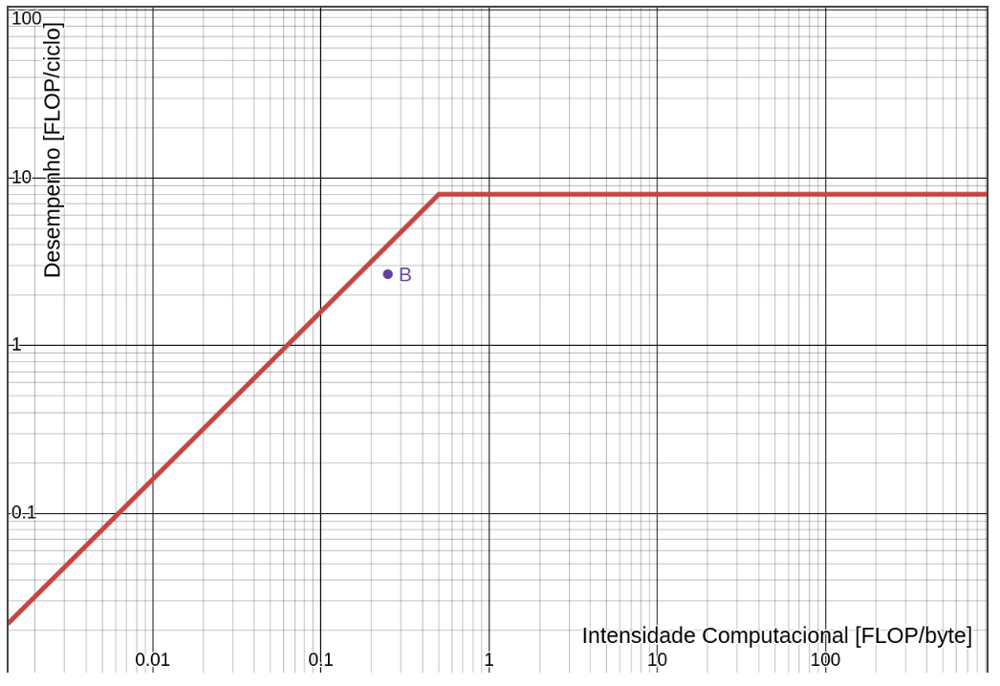

## Configuração Base

* `L = 4`  
* `VLMAX = 16`
* `B = 16`
* `N_VALU = 1`
* `n = 64` então `vl = VMAX = 16`
* `P_peak = 8`
* `I_inf = 0,5`

#### Instruções

| Instruçao | T | N_FLOPS |
|:---------:|:-:|:-------:|
|   VSETVL  | 1 |    0    |
|   VLOAD   | 4 |    0    |
|    VFMA   | 4 |    32   |
|   VSPLAT  | 4 |    0    |
|   VZERO   | 4 |    0    |
|  VREDSUM  | 6 |    16   |
|    FSW    | 1 |    0    |
|    ADD    | 1 |    0    |
|    SLLI   | 1 |    0    |
|    BNE    | 1 |    0    |


### Trace


|  k  |      Instruçao      | vl | Unidade |  E  |  I  |  F  |
|:---:|:-------------------:|:--:|:-------:|:---:|:---:|:---:|
|  1  |    VSETVL x2, x1    |  - |   ALU   |  1  |  1  |  1  |
|  2  |      VZERO v1       | 16 |   VALU  |  2  |  2  |  5  |
|  3  |   SLLI x3, x2, 2    | 16 |   ALU   |  3  |  3  |  3  |
|  4  |   ADD x4, x0, x0    |  - |   ALU   |  4  |  4  |  4  |
|  5  |   ADD x4, x4, x2    |  - |   ALU   |  5  |  5  |  5  |
|  6  |   VLOAD v2, (x5)    | 16 |   LSU   |  6  |  6  |  9  |
|  7  |   VLOAD v3, (x6)    | 16 |   LSU   |  10 |  10 |  13 |
|  8  |   VFMA v1, v2, v3   | 16 |   VALU  |  11 |  14 |  17 |
|  9  |   ADD x5, x5, x3    |  - |   ALU   |  12 |  12 |  12 |
|  10 |   ADD x6, x6, x3    |  - |   ALU   |  13 |  13 |  13 |
|  11 |   BNE x4, x1, LOOP  |  - |   ALU   |  14 |  14 |  14 |
|  12 |   ADD x4, x4, x2    |  - |   ALU   |  15 |  15 |  15 |
|  13 |   VLOAD v2, (x5)    | 16 |   LSU   |  16 |  18 |  21 |
|  14 |   VLOAD v3, (x6)    | 16 |   LSU   |  22 |  22 |  25 |
|  15 |   VFMA v1, v2, v3   | 16 |   VALU  |  23 |  26 |  29 |
|  16 |   ADD x5, x5, x3    |  - |   ALU   |  24 |  24 |  24 |
|  17 |   ADD x6, x6, x3    |  - |   ALU   |  25 |  25 |  25 |
|  18 |   BNE x4, x1, LOOP  |  - |   ALU   |  26 |  26 |  26 |
|  19 |   ADD x4, x4, x2    |  - |   ALU   |  27 |  27 |  27 |
|  20 |   VLOAD v2, (x5)    | 16 |   LSU   |  28 |  30 |  33 |
|  21 |   VLOAD v3, (x6)    | 16 |   LSU   |  34 |  34 |  37 |
|  22 |   VFMA v1, v2, v3   | 16 |   VALU  |  35 |  38 |  41 |
|  23 |   ADD x5, x5, x3    |  - |   ALU   |  36 |  36 |  36 |
|  24 |   ADD x6, x6, x3    |  - |   ALU   |  37 |  37 |  37 |
|  25 |   BNE x4, x1, LOOP  |  - |   ALU   |  38 |  38 |  38 |
|  26 |   ADD x4, x4, x2    |  - |   ALU   |  39 |  39 |  39 |
|  27 |   VLOAD v2, (x5)    | 16 |   LSU   |  40 |  42 |  45 |
|  28 |   VLOAD v3, (x6)    | 16 |   LSU   |  46 |  46 |  49 |
|  29 |   VFMA v1, v2, v3   | 16 |   VALU  |  47 |  50 |  53 |
|  30 |   ADD x5, x5, x3    |  - |   ALU   |  48 |  48 |  48 |
|  31 |   ADD x6, x6, x3    |  - |   ALU   |  49 |  49 |  49 |
|  32 |   BNE x4, x1, LOOP  |  - |   ALU   |  50 |  50 |  50 |
|  33 |  VREDSUM f1, v1, f0 | 16 |   VALU  |  54 |  54 |  59 |
|  34 |  FSW f1 0(x7)       |  - |   LSU   |  60 |  60 |  60 |

### Extrapolação Analítica

Podemos dividir o algorítmo em dois blocos:

**1. Fora do loop**: subdividida em *pré-loop* e *pós-loop*, são sequências de instruções executadas somente uma vez.
    
* *Pré-loop:* o total de ciclos será dado por `max(F) - min(E) + 1 = F_4 - E_1 + 1 = 4 - 1 + 1 = 4`

    |  k  |  E  |  F  |
    |:---:|:---:|:---:|
    |  1  |  1  |  1  |
    |  2  |  2  |  5  |
    |  3  |  3  |  3  |
    |  4  |  4  |  4  |
    

* *Pós-loop:* o total de ciclos será dado por `max(F) - min(E) + 1 = F_34 - E_33 + 1 = 60 - 54 + 1 = 7`


    |  k  |  E  |  F  |
    |:---:|:---:|:---:|
    |  33 |  54 |  59 |
    |  34 |  60 |  60 |

**2. Dentro do loop:** subdividido entre *transição* (primeira iteração) e *recorrência* (segunda iteração em diante).
    
* *Transição:* `max(F) - min(E) + 1 = F_8 - E_5 + 1 = 17 - 5 + 1 = 13`. No que a instrução de j=4 é a que determina o fim da primeira iteração.

    | j |  k  |  E  |  F  |
    |:-:|:---:|:---:|:---:|
    | 1 |  5  |  5  |  5  |
    | 2 |  6  |  6  |  9  |
    | 3 |  7  |  10 |  13 |
    | 4 |  8  |  11 |  17 |
    | 5 |  9  |  12 |  12 |
    | 6 |  10 |  13 |  13 |
    | 7 |  11 |  14 |  14 |

* *Recorrência:* precisamos desconsiderar as sobreposições de ciclos entre iterações subsequêntes. Assim como na transição, em cada execução do loop, a instrução de j=4 será a que termina no maior ciclo.

    > *Iteração 2:* max(F) - (F_8+1) + 1 = F_15 - F_8 = 29 - 17 = 12 
    >
    > | j |  k  |  E  |  F  |
    > |:-:|:---:|:---:|:---:|
    > | 1 |  12 |  15 |  15 |
    > | 2 |  13 |  16 |  21 |
    > | 3 |  14 |  22 |  25 |
    > | 4 |  15 |  23 |  29 |
    > | 5 |  16 |  24 |  24 |
    > | 6 |  17 |  25 |  25 |
    > | 7 |  18 |  26 |  26 | 

    > *Iteração 3:* max(F) - (F_15+1) + 1 = F_22 - F_15 = 41 - 29 = 12
    >
    > | j |  k  |  E  |  F  |
    > |:-:|:---:|:---:|:---:|
    > | 1 |  19 |  27 |  27 |
    > | 2 |  20 |  28 |  33 |
    > | 3 |  21 |  34 |  37 |
    > | 4 |  22 |  35 |  41 |
    > | 5 |  23 |  36 |  36 |
    > | 6 |  24 |  37 |  37 |
    > | 7 |  25 |  38 |  38 | 


    > *Iteração 4:* max(F) - (F_22+1) + 1 = F_29 - F_22 = 53 - 41 = 12
    >
    > | j |  k  |  E  |  F  |
    > |:-:|:---:|:---:|:---:|
    > | 1 |  26 |  39 |  39 |
    > | 2 |  27 |  40 |  45 |
    > | 3 |  28 |  46 |  49 |
    > | 4 |  29 |  47 |  53 |
    > | 5 |  30 |  48 |  48 |
    > | 6 |  31 |  49 |  49 |
    > | 7 |  32 |  50 |  50 |

> `ciclos(n=64) = 4 + 7 + 13 + 3*12 = 60`
> `ciclos(n=64) = 12 + 4*12 = 12*(1+64/16)

> `ciclos(n) = 12*(1+n/16)`

> `ciclos(n=16) = 17+7 = 24`
> `ciclos(n=16) = 12*(1+1) = 24`

> `ciclos(n=32) = 29+7 = 36`
> `ciclos(n=32) = 12*(1+2) = 36`

> `ciclos(n=48) = 41+7 = 48`
> `ciclos(n=48) = 12*(1+3) = 48`

> ciclos(n=1024) = 12*(1+1024/16) = 12*65 = 780
> ciclos(n=2^20) = 12*(1+2^20/16) = 12*65537 = 786444

### Desempenho e Roofline

#### 1. Número de FLOPs

Para esse kernel, a instrução `VREDSUM`, executada somente uma vez após a execução de todos os loops, executa 16 FLOPs. Já a instrução `VFMA`executa 32 FLOPs em cada loop. Portanto, a quantidade total de FLOPs é dada por:

>```
> N_FLOPS = 16 + 32*(n/16) = 16 + 2n
> => N_FLOPS(n=2^20) = 16 + 2^21 FLOPs
>```

#### 2. Tráfego

Temos instrução `FSW` executada pós-loop, que transfere um 16 bytes; e duas instruções `VLOAD` que transferem 16*4 = 64 bytes cada, executadas dentro do loop. Portanto, o tráfego é dado por:

>``` 
> Q = 16 + 2*64*(n/16) = 16 + 8n
> => Q(n=2^20) = (16 + 2^23) bytes
>```


#### 3. Intensidade Computacional

Tendo a quantidade de operações de ponto flutuante `N_FLOPS=16 + 2n` e o tráfego `Q=16 + 8n` em bytes, a intensidade computacional segue:

>```
> I = (16 + 2n)/(16 + 8n) = (8+n)/(8+4n) FLOP/byte 
> => I(n=2^20) = (8+2^20)/(8+2^22) ~ 0.25
>```

#### 4. Desempenho

O desempenho computacional estimado a partir da quantidade de operações `N_FLOPS = 16 + 2n` e do total de ciclos de execução `ciclos(n) = 12*(1+n/16)`, temos:

> ```
> P_estimado = (16 + 2n)/(12*(1+n/16))
> => P_estimado(n=2^20) = (16 + 2^21)/(12*(1+2^16)) FLOP/ciclo
> => P_estimado(n=2^20) ~ 2.67 FLOP/ciclo
> ```

#### 5. Roofline



> ```
> η_roof = P_estimado/P(I) => η_roof = [(16 + 2^21) / (12*(1 + 2^16))] / [16 * (8 + 2^20)/(8 + 2^22)]  ~ 0.67
> ```